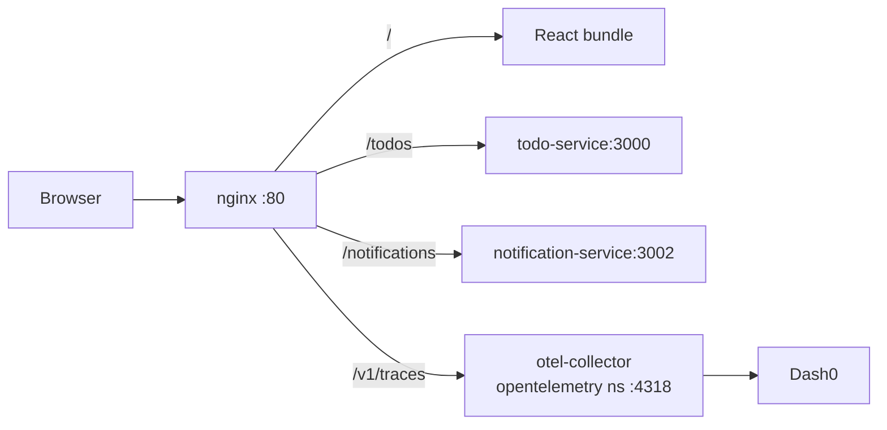

# Architecture



## Proxy routes

From `nginx.conf.template`, rendered at container start so the upstreams come from
the environment:

| Location | Upstream | Purpose |
|---|---|---|
| `/` | the built React bundle | SPA |
| `/todos` | `${TODO_SERVICE_HOST}:${TODO_SERVICE_PORT}` | Todo CRUD |
| `/notifications` | `notification-service:3002` | Recent notifications |
| `/v1/` | `${OTEL_COLLECTOR_HOST}:${OTEL_COLLECTOR_PORT}` | Browser OTLP export |

`/notifications` is hardcoded while `/todos` is templated — a small inconsistency
worth knowing before you go looking for a `NOTIFICATION_SERVICE_HOST` variable that
does not exist.

## Browser telemetry: the Dash0 web SDK

`src/tracing.js` initialises [`@dash0/sdk-web`](https://github.com/dash0hq/dash0-sdk-web),
which provides page views, navigation timing, web vitals, uncaught error tracking,
session tracking, and a span for every `fetch`/XHR.

It is pointed at **this app's own origin**, not at the Dash0 ingress:

```js
endpoint: { url: `${window.location.origin}/telemetry`, authToken: '...' }
```

Two reasons. The `authToken` would be readable by anyone loading the page — the SDK's
README says as much — and proxying to the collector means no ingest token is in the
bundle at all (the OTLP receiver does not authenticate, so the value is an unused
placeholder). And browser telemetry then passes through the same pipeline as the
backends, so `k8sattributes` and `resourcedetection` apply and it reaches Jaeger and
OpenSearch, not Dash0 alone.

Set `REACT_APP_DASH0_URL` and `REACT_APP_DASH0_AUTH_TOKEN` at build time to send
directly to Dash0 instead.

### Two ways this proxy breaks silently

**The `/telemetry` prefix is required.** To avoid instrumenting its own exports the SDK
ignores any request whose URL *starts with* an endpoint URL. With the endpoint set to
the bare origin, every same-origin call — `/todos`, `/notifications` — matches that
prefix, so no fetch spans are created and no `traceparent` is injected. Web events keep
arriving, which makes it look healthy while nothing correlates with the backend.

**The whole prefix must be proxied, not just traces.** Spans go to `/v1/traces`, but
page views, web vitals and errors go to `/v1/logs`. Miss the latter and the SPA
catch-all answers with `index.html`.

Probe both — JSON `{"partialSuccess":{}}` is the collector, HTML means nginx never
proxied it:

```bash
curl -s -X POST http://localhost:3001/telemetry/v1/logs \
  -H 'Content-Type: application/json' -d '{}'
```

## Semantic conventions

The SDK emits the **stable** HTTP attributes — `http.request.method`,
`http.response.status_code`, `url.*` — so the frontend agrees with the Java services
and `validation-service`. It adds its own `dash0.web.*` attributes for RUM concepts.

## No manual spans

The SDK has no manual-span API and does not depend on `@opentelemetry/api`, so
`trace.getTracer()` here would return a no-op tracer. Registering a second SDK to get
one would double-instrument `fetch` and split the trace.

Custom `sendEvent()` calls are deliberately absent: they arrive as logs with no
`traceId`, because they fire after `await fetch(...)` outside any span — duplicating
what the HTTP span already records while losing the correlation. `reportError` is used
for *caught* failures, which the error instrumentation never sees.
