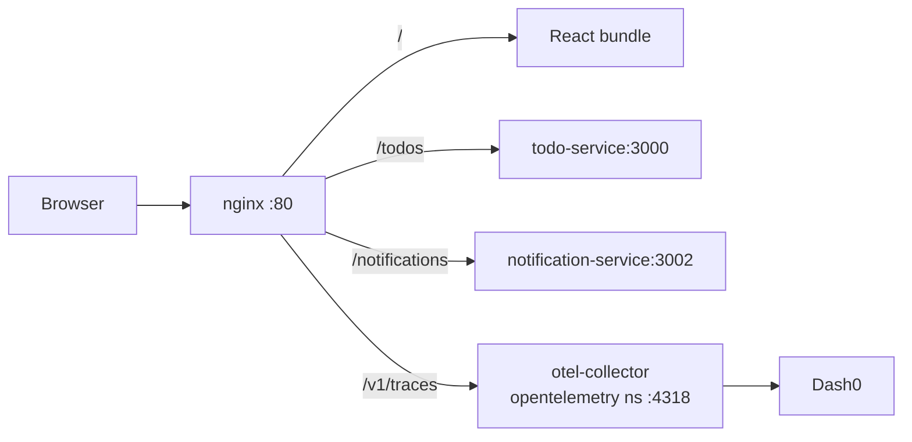

# Architecture

## Proxy routes

From `nginx.conf.template`, rendered at container start so the upstreams come from
the environment:

| Location | Upstream | Purpose |
|---|---|---|
| `/` | the built React bundle | SPA |
| `/todos` | `${TODO_SERVICE_HOST}:${TODO_SERVICE_PORT}` | Todo CRUD |
| `/notifications` | `notification-service:3002` | Recent notifications |
| `/v1/traces` | `${OTEL_COLLECTOR_HOST}:${OTEL_COLLECTOR_PORT}` | Browser OTLP export |

`/notifications` is hardcoded while `/todos` is templated — a small inconsistency
worth knowing before you go looking for a `NOTIFICATION_SERVICE_HOST` variable that
does not exist.

## Why `/v1/traces` is proxied

The browser SDK posts OTLP/HTTP to the same origin it was served from, and nginx
forwards it to the collector in the `opentelemetry` namespace. This avoids CORS
entirely and means the collector never needs to be exposed to the host.

It also means browser spans pass through the same collector pipeline as backend
spans, so the `k8sattributes` and `resourcedetection` processing applies uniformly.

## Semantic conventions

The browser instrumentation emits the **legacy** HTTP attributes (`http.method`,
`http.status_code`), matching the other Node-based instrumentation in this repo and
differing from the Java services, which emit the stable names. Dashboard queries
have to pick one generation; there is no single query that covers both.
