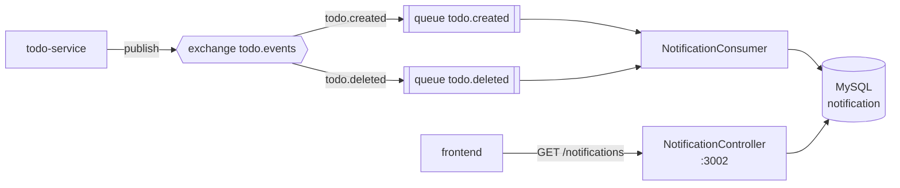

# Architecture

## Code layout

| Class | Responsibility |
|---|---|
| `NotificationConsumer` | Two `@RabbitListener` methods, one per queue |
| `RabbitMQConfig` | Declares exchange `todo.events`, queues and bindings |
| `TodoEvent` | Inbound message payload |
| `Notification` / `NotificationRecord` | Persisted notification |
| `NotificationController` | Read API, `@RequestMapping("/notifications")`, `@CrossOrigin` |

## Read API

| Method | Path | Returns |
|---|---|---|
| `GET` | `/notifications` | The 50 most recent, newest first (`findTop50ByOrderByReceivedAtDesc`) |
| `GET` | `/notifications/count` | Total row count as a bare number |

Unlike `todo-service`, these are **not** paginated — `/notifications` returns a
plain JSON array, so `len()` on the response is the correct way to count it.

## Event contract

Bound to exchange `todo.events`:

| Queue | Routing key |
|---|---|
| `todo.created` | `todo.created` |
| `todo.deleted` | `todo.deleted` |

Both this service and `todo-service` declare the exchange and queues, so startup
order does not matter — whichever comes up first creates the topology.

The queues are durable, so events published while this service is down are
delivered once it returns. That makes "stop the consumer, create some todos, start
it again" a reliable way to demonstrate a backlog draining.
