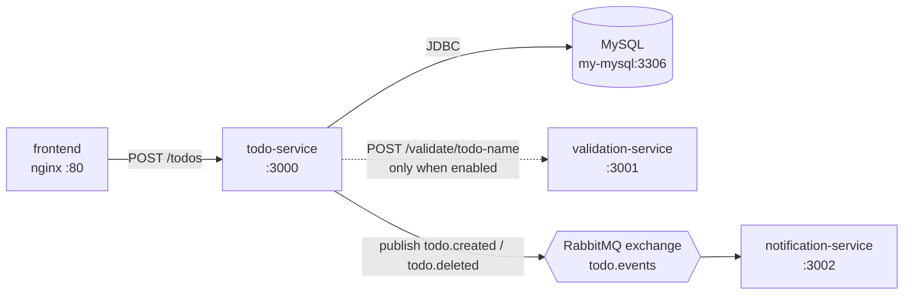

# Architecture

## Request and event flow

The dotted call is conditional — see [Operations](operations.md#configuration).

## Code layout

| Class | Responsibility |
|---|---|
| `TodoController` | REST layer, `@RequestMapping("/todos")` |
| `Todo` | JPA entity |
| `ValidationService` / `ValidationRequest` / `ValidationResponse` | Calls `validation-service` over WebClient |
| `WebClientConfig` | WebClient bean, which is what carries trace context outbound |
| `EventPublisher` / `TodoEvent` | Publishes to RabbitMQ |
| `RabbitMQConfig` | Exchange, queue and routing-key declarations |
| `ResourceNotFoundException` | Maps a missing todo to HTTP 404 |

## Event contract

Published to exchange **`todo.events`** (topic):

| Routing key | Queue | Meaning |
|---|---|---|
| `todo.created` | `todo.created` | A todo was created |
| `todo.deleted` | `todo.deleted` | A todo was deleted |

`notification-service` binds one `@RabbitListener` per queue. The exchange, queues
and routing keys are declared in `RabbitMQConfig` on both sides, so whichever
service starts first creates them.

Trace context crosses this boundary as message headers, which is why a trace
starting in the browser still shows the notification work as a child span rather
than as an unrelated trace.

## Ownership boundaries

`todo-service` **provides** `todo-api` and `rabbitmq-events`, and **consumes**
nothing declared in the catalog. `rabbitmq-events` is owned by
**notifications-team** even though this service publishes to it — the contract
belongs to the consumer side in this demo, which is a deliberate illustration of
shared-contract ownership rather than an accident.
